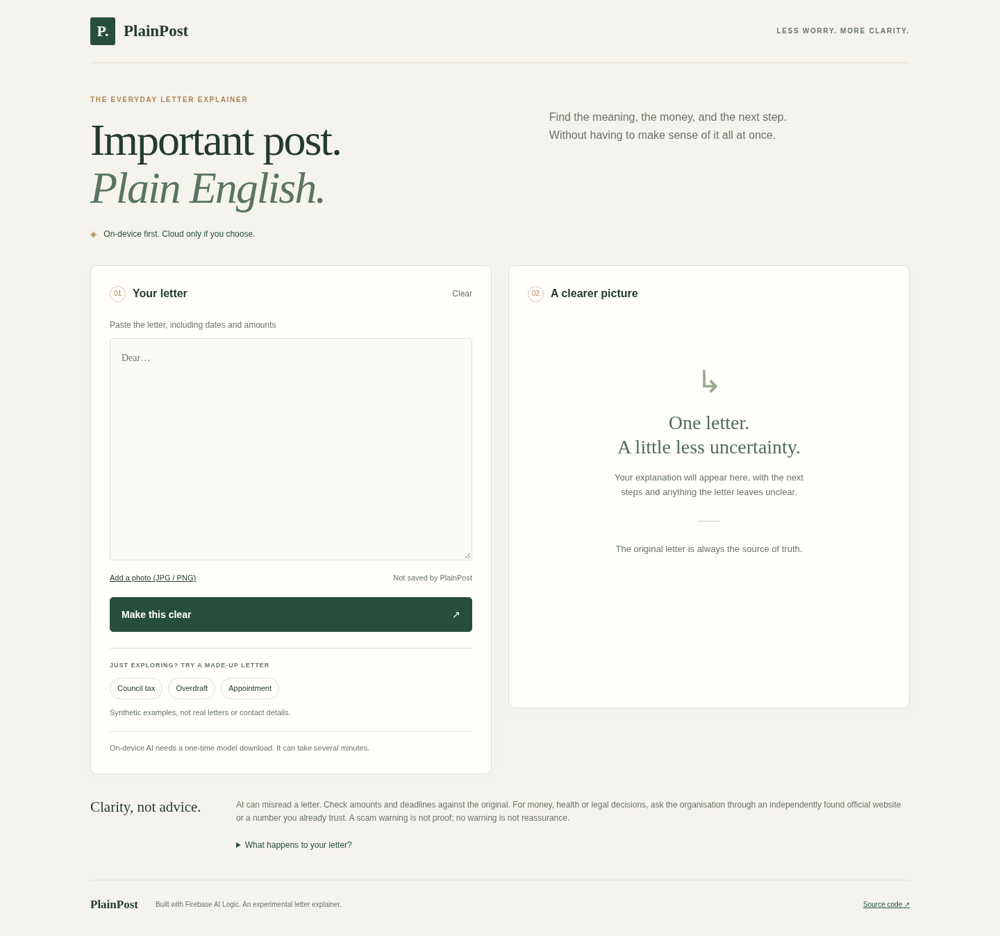

# PlainPost

Important post. Plain English.

PlainPost turns an official letter into a short explanation: what it means, what to do, the money mentioned, and anything left unclear. It is an experimental explainer, not legal, financial or medical advice.

**[Open the demo](https://vaibhav4046.github.io/plainpost/)**



## How it works

1. Paste a letter or attach a JPG/PNG photo (up to 10 MB, resized in the browser).
2. PlainPost checks whether the Chrome Prompt API is available for that input.
3. It attempts **on-device inference first**, using Firebase AI Logic's `ONLY_ON_DEVICE` mode and Gemini Nano.
4. If local processing is unavailable or fails, it asks permission before making a cloud generation request. Declining does not send the letter to the cloud.
5. With permission, Firebase AI Logic calls `gemini-3.5-flash-lite` through the Gemini Developer API. The displayed result names the path that ran.

The examples are synthetic. Do not paste sensitive personal information into the cloud demo. Check every amount and deadline against the original letter. For decisions, verify through an independently found official website or a number you already trust.

## Firebase AI Logic integration

The browser imports the Firebase JavaScript SDK 13.4.0 directly from Google's CDN. `docs/src/engine.mjs` calls `getAI`, `getGenerativeModel`, `initializeDeviceModel` and `generateContent` at runtime. This is not a pre-generated explanation or a server proxy.

`docs/src/model-config.mjs` keeps the two model configurations explicit:

- Cloud: `inCloudParams`, system instructions and JSON response schema.
- Device: `onDeviceParams.createOptions`, expected input/output languages, system prompt, and `promptOptions.responseConstraint`.

The application chooses the two strict modes separately so it can put its own consent gate between them. It does not silently enable automatic cloud fallback.

Firebase App Check uses reCAPTCHA Enterprise. App Check and CDN requests may contact Google even when a letter is processed locally. The privacy claim concerns letter content, not an absence of all network traffic. PlainPost has no application database and does not save letters, but Google processes cloud requests under its own terms.

## Run locally

Requires Node.js 18+ for the small static server and Node.js 20+ for development tests.

```sh
npm install
npm start
# http://localhost:4175
npm test
```

The default Firebase configuration is for the hosted demonstration. A fresh localhost setup needs its own registered App Check debug token, or a Firebase project and App Check configuration you control. Never commit debug tokens. A local file named `docs/src/appcheck-debug.local.mjs` can export `appCheckDebugToken`; it is gitignored and must not be deployed.

For your own deployment, replace `docs/src/firebase-config.mjs` with your Firebase web configuration and App Check site key. Enable Firebase AI Logic with the Gemini Developer API and register the hosting domain in App Check. A Firebase web API key identifies the project; it is not a server credential. Keep billing disabled if you want a hard no-paid-services setup. Free quota can be exhausted.

## Local-model requirements and honest limits

Desktop Chrome with the Prompt API and an actual Gemini Nano download is required. A version number or the existence of `LanguageModel` alone is not proof of usable inference. Hardware, language, policy and model availability also matter. Photo support can differ from text support.

The current development environment cannot run a real Nano model. A Chromium test build exposed a placeholder Prompt API, not a genuine model, and its output was rejected. That is **not** evidence of on-device inference. Local-model execution remains a release/submission validation gap. The application must not be described as having passed both inference paths until that check is complete.

Cloud inference was exercised through the deployed interface on 21 November 2026 before the SDK/UI revision. The revised SDK configuration still needs a deployed live-cloud check. Automated schema and consent tests are useful, but do not prove model quality or real on-device execution.

## Tests

```sh
npm test
```

Tests cover structured response validation and separate cloud/device configuration. Any simulated-model UI tests are explicitly marked as simulations. They are not benchmark scores, user studies, or evidence that a real local model works.

## Design and safety choices

- The original letter remains the source of truth.
- No automatic payments, replies or links to a letter's payment destination.
- Rendered model text is HTML-escaped.
- Required response fields are checked before rendering.
- Letter content is treated as untrusted input in the model instruction, though prompt instructions alone cannot guarantee resistance to adversarial text.
- A scam flag is a caution, not a verdict. No flag is not an assurance.
- No invented users, usage metrics or outcome claims.

## Build and attribution

Built for BuildHybridAI 2026 using Firebase AI Logic, the Gemini Developer API, Chrome's Prompt API, and AI coding assistance. The application is a new project; the initial static-server scaffold was adapted from a previous small static app. Fonts are system fonts; the interface uses no external stock imagery.

MIT license, see [LICENSE](LICENSE).

## References

- [Firebase hybrid web quickstart](https://firebase.google.com/docs/ai-logic/hybrid/web/get-started)
- [Hybrid model configuration](https://firebase.google.com/docs/ai-logic/hybrid/web/configuration-options)
- [Structured output](https://firebase.google.com/docs/ai-logic/hybrid/web/generate-structured-output)
- [Chrome built-in AI requirements](https://developer.chrome.com/docs/ai/get-started)
- [Gemini API terms](https://ai.google.dev/gemini-api/terms)
